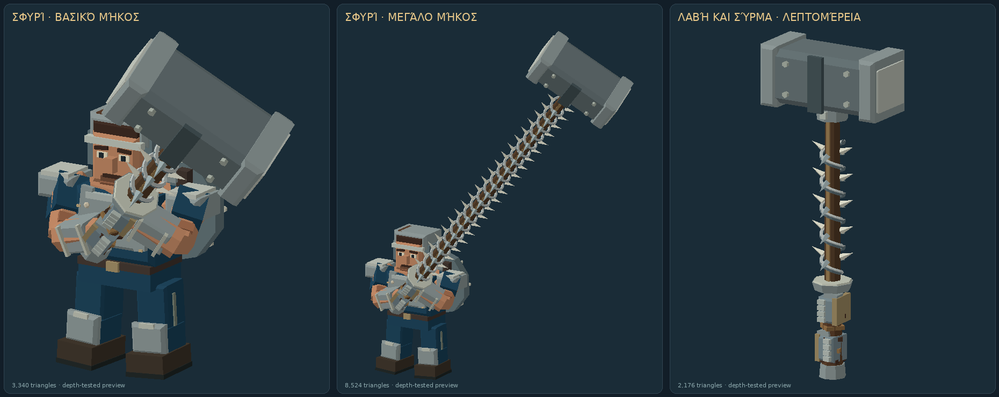

# IRONFALL — AIM13: αγκαθωτό κοντάρι και ενιαία ένδειξη ρίψης

## Κοντινή και μακρινή επαφή

Η εικόνα προκύπτει από την πραγματική γεωμετρία του μοντέλου με ξεχωριστή απόδοση εικόνας· δεν είναι στιγμιότυπο εκτέλεσης browser.

Το σφυρί διατηρεί μία κεφαλή και όλο το αναβαθμισμένο μήκος του. Τα μεταλλικά σφυριά έχουν προστατευτικό μετά τη λαβή των δύο χεριών και πραγματική τρισδιάστατη περιέλιξη με αγκάθια στο εκτεθειμένο κοντάρι. Το τμήμα που κρατούν τα χέρια παραμένει ελεύθερο. Τα πρώτα ξύλινα όπλα διατηρούν τη δική τους αμβλεία επαφή.

- Η κεφαλή κρατά την πλήρη ζημιά, τη βαριά αντίδραση και το knockback.
- Το αγκαθωτό τμήμα κάνει το 55% της ζημιάς της αντίστοιχης επίθεσης, με flash, τίναγμα του σώματος, σύντομες γραμμές slash και μεταλλικό ήχο επαφής.
- Το slash δίνει μία περιορισμένη ώθηση προς τον παίκτη και προς την πλευρά της αιώρησης. Δεν δημιουργεί σύνδεση που κρατά ή κουβαλά τον εχθρό. Η ταχύτητα σβήνει με την υπάρχουσα φυσική, οι τοίχοι εξακολουθούν να εμποδίζουν την κίνηση και οι βαρείς εχθροί μετακινούνται λιγότερο.
- Η κοντινή επαφή ελέγχει την ορατή αγκαθωτή περιοχή και την κίνησή της ανάμεσα στα βήματα της προσομοίωσης. Δεν προκαλεί ζημιά σε ολόκληρο τον κύκλο εμβέλειας ή μέσα στην ασφαλή λαβή.
- Κεφαλή και σύρμα μοιράζονται το ιστορικό χτυπημάτων: ένας εχθρός δέχεται μία ζημιά ανά κανονική αιώρηση. Η περιστροφή εξακολουθεί να χρειάζεται πραγματική αρχική επαφή και νέες, χωριστές επαφές για να συντηρείται.

## Αρχικό χτύπημα και ρίψη

Κάθε νέα αλυσίδα επιθέσεων ξεκινά οριζόντια, τόσο με ένα όσο και με δύο χέρια. Τα επόμενα χτυπήματα διατηρούν τις διαφορετικές κινήσεις. Η αλυσίδα επανέρχεται μετά από παύση 0,75 δευτερολέπτων από το τέλος του χτυπήματος και μετά τις ενέργειες που τη διακόπτουν.

Το ξεχωριστό στόχαστρο ρίψης αφαιρείται. Το τόξο εμβέλειας μένει και ένα γεμάτο, εικονογραφημένο βέλος ενώνεται με το μπροστινό κέντρο του. Λειτουργεί τόσο με δύο πατήματα όσο και με κράτημα / άφημα. Το μέγεθος της εικόνας παραμένει ευανάγνωστο ακόμη και με μεγάλες αναβαθμίσεις εμβέλειας.

Στο κινητό η κατεύθυνση ορίζεται από τον υπάρχοντα αριστερό μοχλό και διατηρείται όταν τον αφήνεις. Η μετακίνηση του δαχτύλου πάνω στο κουμπί ρίψης δεν δημιουργεί δεύτερο χειριστήριο. Στον υπολογιστή παραμένει η κατεύθυνση με το ποντίκι. Η προαιρετική αυτόματη στόχευση εξακολουθεί να είναι ξεχωριστή ρύθμιση.

## Πληκτρολόγιο

Στον υπολογιστή το **Q** ανοίγει και κλείνει το πάνελ αναβαθμίσεων. Το κράτημα του πλήκτρου δεν το αναβοσβήνει. Η μάχη συνεχίζεται, το Escape κλείνει πρώτα το πάνελ και η πληκτρολόγηση σε πεδία εισαγωγής δεν ενεργοποιεί τη συντόμευση. Το U παραμένει εναλλακτική συντόμευση.

## Απόδοση περιστροφής

Οι σύντομες γραμμές των χτυπημάτων επαναχρησιμοποιούν μία περιορισμένη συλλογή γεωμετρίας και υλικών. Το μέγιστο πλήθος ορατών γραμμών παραμένει 24 στη χαμηλή ποιότητα και 48 στην υψηλή, με την ίδια διάρκεια, χρώμα και ένταση. Μετά την αρχική δημιουργία τους, οι συνεχείς επαφές δεν δημιουργούν και καταστρέφουν ξανά αυτά τα GPU buffers.

Οι έλεγχοι των διακοσμητικών που αποσπώνται μαζί με ένα σπασμένο τοίχωμα χρησιμοποιούν απευθείας αριθμητικές συγκρίσεις, χωρίς ένα προσωρινό αντικείμενο ορίων για κάθε συνδυασμό κομματιών. Οι βαθμολογίες επιλογής των κομματιών υπολογίζονται μία φορά ανά στάδιο. Η παραγωγή των ορατών θραυσμάτων γράφει απευθείας στα τελικά buffers, με προϋπολογισμένο μέγεθος και μετασχηματισμούς.

Σε 78 επαναλήψιμα σενάρια με 273 γεγονότα καταστροφής, τα αποσπασμένα κομμάτια, οι ορατές γεωμετρίες και η εξέλιξη των θραυσμάτων ήταν ακριβώς ίδια με πριν. Οι μετρήσεις CPU σε δέκα κτίρια και πέντε στάδια έδειξαν περίπου 21% μικρότερο κόστος. Αυτό δεν αποτελεί μέτρηση FPS σε κινητό ή browser.

## Έλεγχοι

Οι δοκιμές καλύπτουν πραγματικές επαφές σύρματος και κεφαλής, φορά και πεπερασμένη διάρκεια της ώθησης, ασφαλή λαβή, εμπόδια, αποφυγή διπλής ζημιάς, συντήρηση περιστροφής, γεωμετρία και αλλαγές εμβέλειας. Οι δοκιμές browser ελέγχουν mouse / touch και τις δύο μορφές ρίψης. Η αυτοματοποίηση Chromium δεν αποτελεί δοκιμή σε φυσικό iPhone ή Safari.

Ο τελικός τοπικός έλεγχος πέρασε **469/469 δοκιμές**. [Αποτελέσματα, μετρήσεις απόδοσης και όρια επαλήθευσης](docs/aim13-validation.md).
